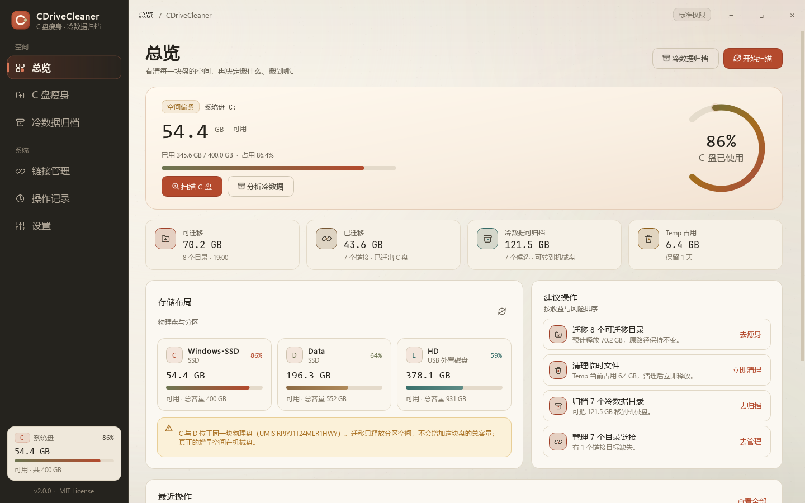
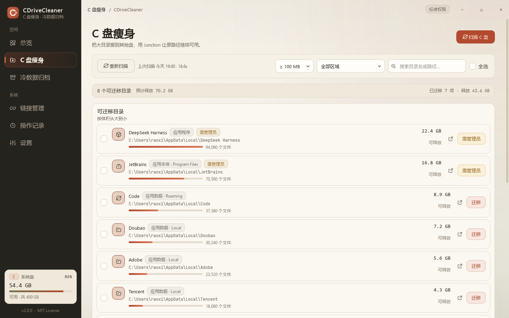
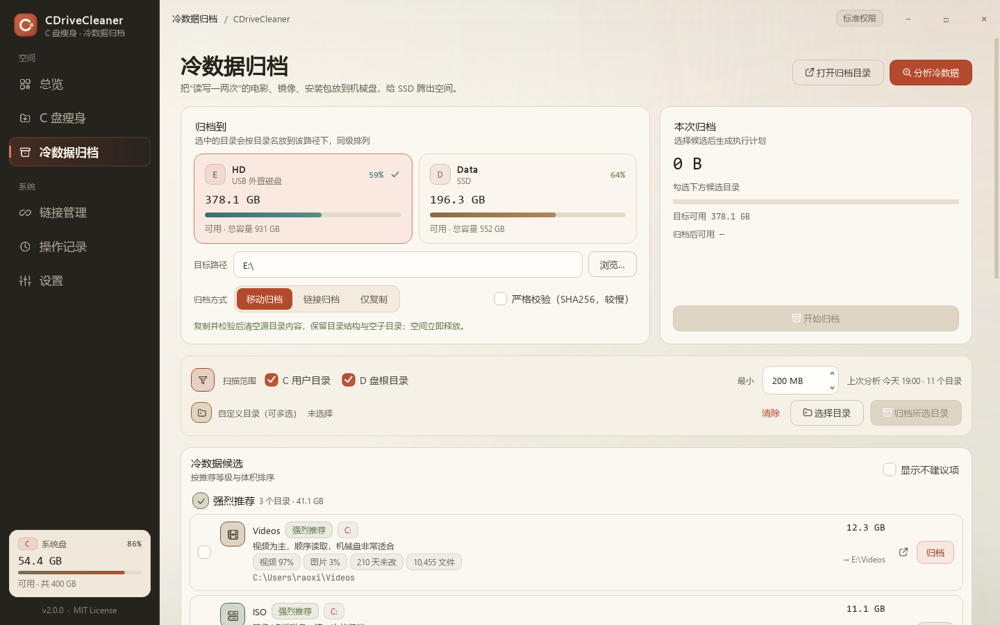
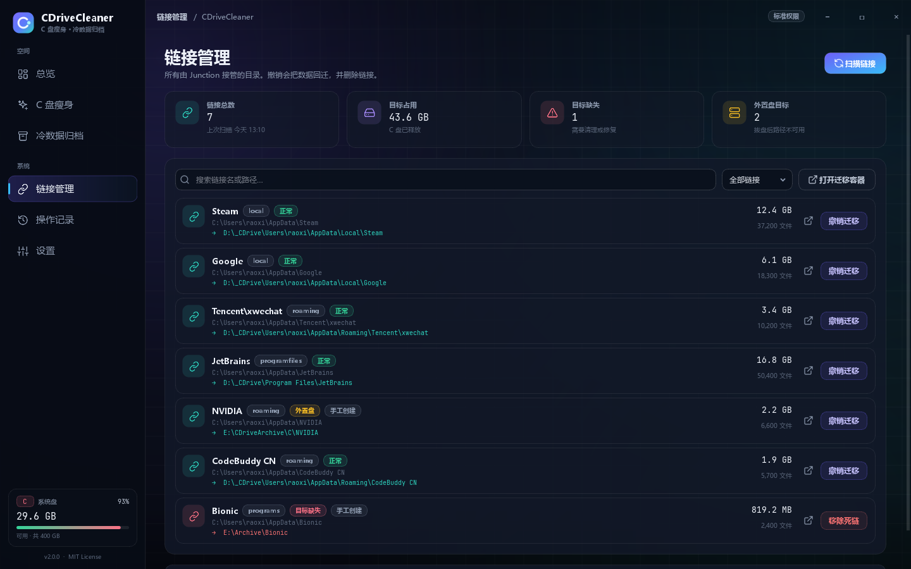
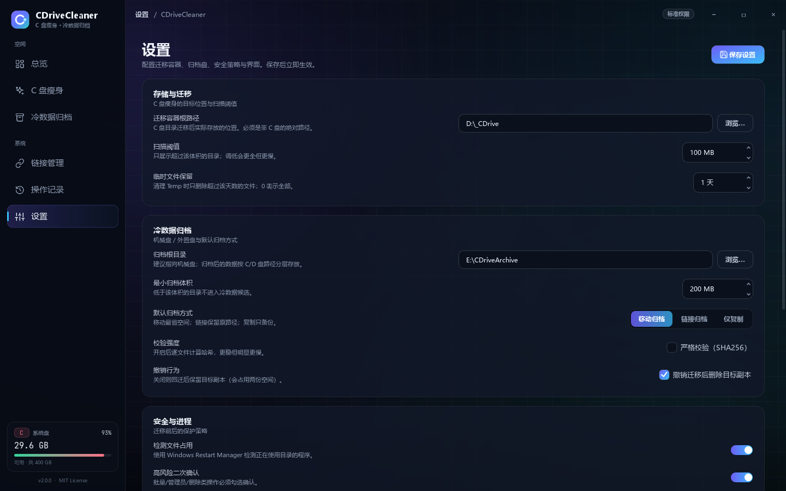
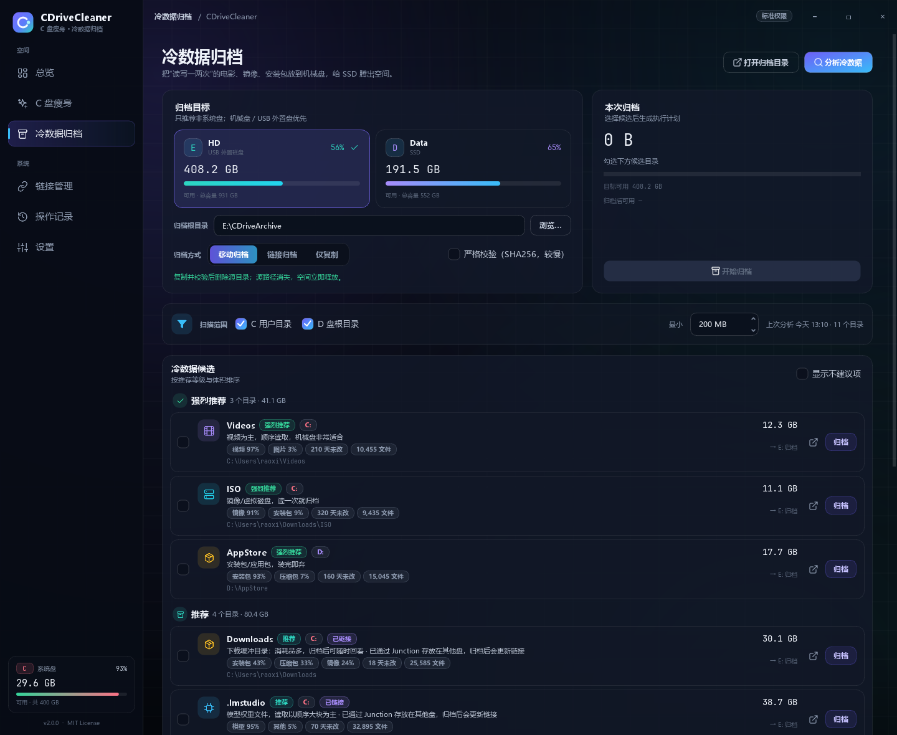
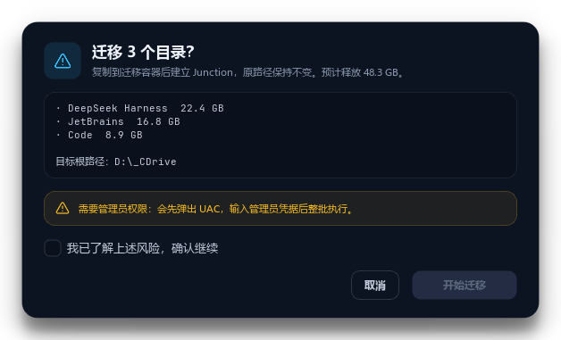
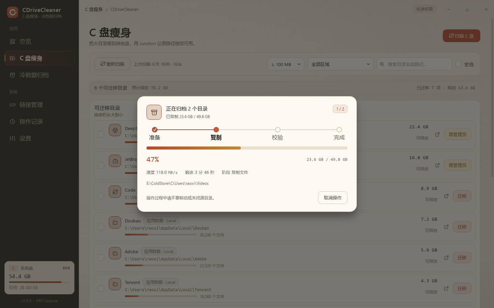

# CDriveCleaner v2

<p align="center">
  <a href="https://github.com/Enkrid-Rao/CDriveCleaner/releases/latest">
    
  </a>
  
  
  
  
</p>

> **C 盘瘦身，冷数据归档。**
> 用 NTFS Junction 把 C 盘大目录无损搬到其他盘；按 IO 特征把电影、镜像、安装包、模型归档到机械盘。

<!-- 文档截图 -->


## 它解决什么问题

Windows 用久了 C 盘会满：`AppData`、`Program Files`、`ProgramData` 里堆满应用数据。
但你的机器可能和本机一样——**C 和 D 是同一块 SSD 的两个分区**，在 C/D 之间搬来搬去，
物理盘总容量一点没变。真正空闲的，往往是那块机械盘（例如 `E:`）。

CDriveCleaner v2 同时处理两件事：

1. **C 盘瘦身**：把大目录复制到迁移容器，校验通过后删除原目录，在原位置建立 Junction。
   应用仍然访问 `C:\...`，实际读写落在 D 盘；随时可以撤销回迁。
2. **冷数据归档**：按「IO 模式」而不是「文件大小」识别冷数据，把视频、镜像、安装包、
   模型权重等移到机械盘。已经通过 Junction 放在 D 盘的数据，也可以二次归档到 E 盘，
   工具会把链接自动改指到新位置。

## 界面

| 总览 | C 盘瘦身 |
|---|---|
|  |  |

| 冷数据归档 | 链接管理 |
|---|---|
|  |  |

| 操作记录 | 设置 |
|---|---|
|  |  |

## 功能

### C 盘瘦身

- 扫描 7 类区域：用户主目录、应用数据（Local / Roaming / LocalLow）、应用程序、
  ProgramData、Program Files。
- 可调阈值（50 MB ~ 1 GB），搜索、区域筛选、按体积排序。
- **多选批量迁移**，一次确认；需要管理员的目录会合并为一次 UAC。
- 迁移流程：预检（路径红线、空间、文件锁）→ 生成清单 → robocopy 复制 →
  逐文件校验 → 删除源 → 创建 Junction。
- **失败自动回滚**：Junction 创建失败会把已验证的数据回拷到原位置并再次校验。
- 已迁移目录统一在「链接管理」里查看，支持撤销、移除死链、打开位置。

### 冷数据归档

- **目标盘识别**：枚举卷 → 分区 → 物理盘，标注 SSD / 机械硬盘 / USB 外置盘；
  默认推荐非系统盘。
- **冷数据判据**：扩展名构成（视频 / 镜像 / 安装包 / 压缩包 / 模型 / 图片）、
  最后修改时间、文件平均大小。
  - 推荐：影视、ISO、虚拟机镜像、安装包、模型权重、照片素材、长期未动的归档。
  - 不推荐：聊天数据库、代码仓库、`node_modules`、浏览器缓存、IDE 索引。
- **三种模式**：
  1. **移动归档**：复制 → 校验 → 删源，源路径消失。
  2. **链接归档**：复制 → 校验 → 删源 → Junction 指回目标，程序仍可访问原路径。
  3. **仅复制**：只复制并校验，保留源目录。
- **已链接冷数据二次归档**：例如 `C:\Users\你\Downloads` 已经 Junction 到 D 盘，
  工具会把 D 盘上的真实数据搬到 E 盘，并把 `Downloads` 的链接改指到 E；
  C 盘路径完全不变。



- **可回迁**：普通移动归档可在「操作记录」里回迁；链接归档会保留原路径。

### 安全与可追溯

- 操作前检查：磁盘根目录 / Windows / 回收站 / 系统组件等红线，空间余量，
  Restart Manager 文件锁 + 进程路径双重检测。
- 校验：文件数、总字节、逐文件大小；可选 SHA256 严格校验。
- 删除：自研 `safe_delete_tree`，**永不递归进入 Junction / Symlink**，
  避免旧工具误删迁移目标。
- 操作审计：每次操作写入 `state/audit.jsonl`（时间、路径、大小、结果、校验状态），
  「操作记录」可查看详情、撤销、导出 CSV。
- 运行日志：按天写入 `logs/CDriveCleaner-YYYY-MM-DD.log`。

| 操作确认 | 执行进度 |
|---|---|
|  |  |

## 下载与安装

### 安装版（推荐）

下载 `CDriveCleaner-Setup-v2.0.0.exe`，双击安装。默认安装到当前用户目录，
无需管理员权限；也可以选择为所有用户安装。

- 开始菜单 / 可选桌面快捷方式
- 卸载程序
- 配置、日志、审计保存在 `%LOCALAPPDATA%\CDriveCleaner\`（卸载不会删除）

### 便携版

下载 `CDriveCleaner-Portable-v2.0.0.zip`，**解压整个文件夹**后双击
`CDriveCleaner.exe`。目录中的 `portable.flag` 会让程序把配置和日志写在
`data\` 子目录，整个文件夹可以放在 U 盘或移动硬盘里。

> 便携版不要只复制 exe，`_internal` 目录必须一起保留。

发布校验信息与安装/卸载验证见 [docs/RELEASE-v2.0.0.md](docs/RELEASE-v2.0.0.md)。

### 系统要求

- Windows 10 / 11，64 位
- 迁移需要 NTFS（Junction 依赖）
- 归档目标建议为机械硬盘；USB 外置盘可用，但拔盘后目标路径不可用

## 从源码运行

```powershell
git clone https://github.com/Enkrid-Rao/CDriveCleaner.git
cd CDriveCleaner
python -m pip install PySide6
python -m cdc
```

也可以直接双击 `start.bat`（在当前目录启动 `python -m cdc`，缺少 Python/PySide6 时给出提示）。

开发环境：

```powershell
python -m unittest discover -s tests -v
python -m cdc --self-check
python -m cdc --diagnose
```

## 工作原理

### Junction 迁移

```
迁移前： C:\Users\你\AppData\Roaming\JetBrains    16 GB 实际数据
迁移后： C:\Users\你\AppData\Roaming\JetBrains  → Junction (0 KB)
         D:\_CDrive\Users\你\AppData\Roaming\JetBrains   16 GB 实际数据
```

应用读写 `C:\Users\你\AppData\Roaming\JetBrains` 时，NTFS 自动重定向到 D 盘。
对应用透明，可以一键撤销。

### 冷数据二次归档

```
归档前： C:\Users\你\Downloads  → Junction → D:\_CDrive\Users\你\Downloads (30 GB)
归档后： C:\Users\你\Downloads  → Junction → E:\CDriveArchive\C\Users\你\Downloads (30 GB)
         D 盘旧目标已删除，C 盘路径不变
```

### 为什么不用 robocopy /MOVE

`/MOVE` 是「复制一个文件、删一个文件」的流式行为。中途断电、盘掉线、空间不足，
可能出现「源删了、目标没写全」。本工具坚持 **复制 → 校验 → 删源**，
校验不通过绝不删除源。

## 数据位置

| 运行方式 | 配置 / 审计 / 日志 |
|---|---|
| 安装版 | `%LOCALAPPDATA%\CDriveCleaner\` |
| 便携版 | `<程序目录>\data\` |
| 源码 | 仓库根目录（兼容旧 `config.json`） |

主要文件：

```
config.json                 配置（首次运行自动生成）
state/audit.jsonl           操作审计（每次操作一行）
state/manifests/*.json      校验清单
state/cache/                扫描缓存
logs/CDriveCleaner-*.log    运行日志
```

## 旧版迁移

- 直接读取 v1 `config.json`（`target_base` / zones / threshold），首次保存时升级为 v2。
- 已有的 Junction 不需要重建；链接管理页直接识别。
- v1 创建的无来源标记链接：撤销时默认保留目标副本，可手动清理。

## 构建

```powershell
# 1. 构建 onedir 载荷 + 便携 zip + 安装包
powershell -ExecutionPolicy Bypass -File packaging\build.ps1

# 2. 只构建 exe 载荷
python -m PyInstaller --noconfirm --clean packaging\CDriveCleaner.spec

# 3. 只编译安装包（需要 Inno Setup 6.5+）
& "C:\Program Files (x86)\Inno Setup 6\ISCC.exe" packaging\installer.iss
```

产物在 `dist/`：

```
dist/CDriveCleaner/CDriveCleaner.exe
dist/CDriveCleaner-Portable-v2.0.0.zip
dist/CDriveCleaner-Setup-v2.0.0.exe
```

## 项目结构

```
cdc/
  app.py              入口：GUI / 单实例 / 自检 / 提权 helper
  core/
    config.py         v2 配置 + v1 兼容
    windows.py        PowerShell / 磁盘 / Junction / 安全删除 / 文件锁
    safety.py         路径红线 / 空间预检 / 目标标记
    scanner.py        C 盘扫描 + 冷数据分析
    operations.py     迁移 / 撤销 / 归档 / 回迁 / 清理 / 审计
    jobs.py           提权作业协议
    applog.py         运行日志
  ui/
    theme.py icons.py widgets.py
    window.py state.py
    pages/           总览 / 瘦身 / 归档 / 链接 / 记录 / 设置
packaging/            PyInstaller spec / Inno Setup / build.ps1
tests/                unittest（真实临时目录 + Junction）
tools/                UI 截图、图标生成等开发工具
docs/                 当前设计文档、截图；旧方案在 docs/archive/
legacy/v1/            v1 源码归档（不参与 v2 运行与构建）
```

## 风险声明

**此工具会移动文件位置并修改文件系统链接。** 虽然已包含清单校验、失败回滚、
安全删除与审计，但任何文件操作都有风险：

- 迁移前请关闭相关应用程序；
- 建议先备份重要数据；
- 不要把机械盘上的「正在运行的程序」链接过去（拔盘即失效）；
- ProgramData / Program Files 需要管理员权限；
- 便携版退出前请确认没有正在复制或校验的任务。

本项目仅供个人使用，作者不对数据丢失负责。

## 路线图

- [x] v2.0：全新 UI、冷数据归档、链接管理、审计、提权作业、安装版 / 便携版
- [ ] 内置 Everything 索引可选加速（默认原生扫描保证准确）
- [ ] 定时冷数据归档计划
- [ ] 英文界面

## 许可证

[MIT](LICENSE)

---

**English abstract**：CDriveCleaner is a Windows desktop utility for freeing up
system-drive space. It moves large directories to another drive with NTFS
junctions (transparent to applications, reversible), and archives cold data
(videos, ISOs, installers, model weights) to a mechanical disk based on IO
patterns. Includes manifest verification, automatic rollback, Restart Manager
lock detection, audit log, installer and portable builds.
