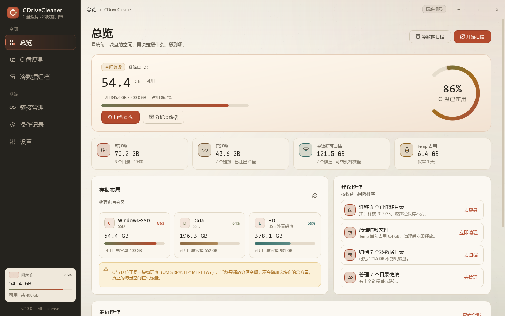

# CDriveCleaner v2.0.0

> **C 盘瘦身，冷数据归档。**
> 用 NTFS Junction 把 C 盘大目录无损搬到其他盘；按 IO 特征把电影、镜像、安装包、模型归档到机械盘。



## 本次更新

### 新增：冷数据归档

- 自动识别 SSD / 机械硬盘 / USB 外置盘，默认推荐非系统盘。
- 按 **IO 模式** 而不是单纯按大小识别冷数据：
  - 视频、ISO / 虚拟机镜像、安装包、压缩归档、模型权重、照片素材 → 推荐；
  - 聊天数据库、代码仓库、`node_modules`、浏览器缓存、IDE 索引 → 不推荐。
- 三种模式：**移动归档 / 链接归档 / 仅复制**。
- **已链接冷数据二次归档**：C 盘路径已是 Junction 时，把 D 盘真实数据搬到机械盘，
  删除旧目标并更新 Junction；C 盘原路径保持不变。

### 重构与安全

- 新架构：`cdc/core` + `cdc/ui`，v1 源码完整归档。
- 复制 → 清单校验 → 才允许删源；校验失败绝不删除源目录。
- 自研安全删除：递归时遇到 Junction / Symlink 只删链接，不进入目标。
- 迁移创建链接失败自动回拷；撤销失败自动恢复链接。
- Restart Manager 文件锁检测 + 进程路径兜底。
- 每次操作写入 `audit.jsonl`，支持历史详情、撤销 / 回迁、CSV 导出。
- 管理员操作一次 UAC 执行整批，GUI 实时读取进度。

### 全新 UI

- 极光玻璃风格，6 个页面：总览 / C 盘瘦身 / 冷数据归档 / 链接管理 / 操作记录 / 设置。
- C 盘环形仪表、物理盘拓扑、C/D 同盘提示、批量选择、搜索筛选。
- 全屏进度面板、安全确认弹窗、Toast、运行日志。
- 更多截图见 [docs/screenshots](https://github.com/Enkrid-Rao/CDriveCleaner/tree/main/docs/screenshots)。

## 下载

| 资产 | 说明 |
|---|---|
| `CDriveCleaner-Setup-v2.0.0.exe` | 安装版（Inno Setup），默认当前用户安装，可选所有用户 |
| `CDriveCleaner-Portable-v2.0.0.zip` | 便携版，解压即用，配置/日志写在 `data\` |
| `CDriveCleaner-v2.0.0-SHA256SUMS.txt` | 下载文件校验 |

### 安装版

双击 Setup，安装后从开始菜单或桌面快捷方式打开。  
配置、日志、审计在 `%LOCALAPPDATA%\CDriveCleaner\`。

### 便携版

解压整个 zip 后双击 `CDriveCleaner.exe`，**保留 `_internal` 目录**。  
配置和日志在旁边的 `data\`，整个文件夹可以搬到 U 盘。

## 验证

- 27 项单元 / UI smoke 测试通过
- 真实临时目录完成迁移 → 撤销、移动归档 → 回迁、链接归档
- 提权 helper 的 job / progress / result 协议通过
- 安装包静默安装 → 自检 → 卸载通过
- 便携包解压 → 自检 / smoke → `data\` 生成通过

SHA256：

```
E6EB9A78863920848D3C4E9C4EBA6334F4B67227B4AC78FC8AA10ECCF0B942B0  CDriveCleaner-Setup-v2.0.0.exe
D50B759A6FF3DDF2B87604B9D452442C38011E7EFDCE5B4A6A7F3231738421ED  CDriveCleaner-Portable-v2.0.0.zip
```

## 已知限制

- 未做代码签名，Windows SmartScreen 可能提示，请核对哈希后再运行。
- 链接归档依赖目标盘在线；拔掉 USB 外置盘后原路径不可用。
- 已链接冷数据归档暂不支持一键回迁；普通移动归档支持。
- 仓库只发布 Windows x64 版本，需要 Windows 10/11。
