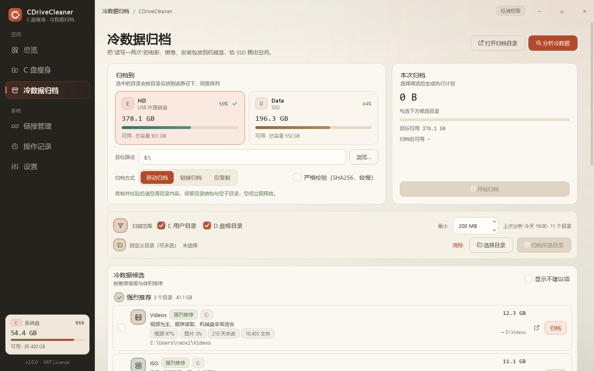

# CDriveCleaner v2.1.0

> 温暖纸张新界面 + 归档语义修正：按目录名同级归档、保留源目录结构、自定义目录可多选。

## 界面重做

- 移除深蓝/极光风格，改为暖纸张、墨色侧边栏与赭红主色。
- 正文默认 14px，辅助文字最低 12px；UI 字体改为 Segoe UI Variable Text + 微软雅黑，数字/路径才使用等宽字体。
- 全部图标重绘为统一的「墨线 + 单色实点」几何风格，应用图标同步更新。

## 归档修复

- **复制速度**：进度面板显示全程平均速度，不再出现几 KB/s 的假速度。
- **移动归档**：复制并校验后**清空源目录内容，保留目录与空子目录**，不再删除目录本身。
- **按目录名同级归档**：选中多个目录 + 目标路径后，结果是 `目标路径\<目录名>`，例如：
  - 选中 `D:\Downloads\Software`、`D:\Downloads\ISO`
  - 目标 `E:\`
  - 结果 `E:\Software`、`E:\ISO`
- **自定义目录可多选**：除推荐候选外，可一次选择多个任意目录直接归档。
- **目标路径更清楚**：UI 从“归档根目录”改为“归档到 / 目标路径”，候选行直接显示完整目标路径。
- 默认归档路径由 `E:\CDriveArchive` 更名为与源盘无关的 `ColdStore`；若配置仍指向旧名且目录不存在，会自动迁移。
- 目录名冲突会阻止操作，避免两个不同来源覆盖到同一目标。

## 兼容与验证

- 旧 `config.json` 自动升级；默认归档方式、审计、Junction 逻辑保持兼容。
- 归档/撤销/清空结构/扫描/UI smoke 测试通过。
- 安装包、便携包、自检与提权 helper 均重新构建验证。

## 下载

| 资产 | 说明 |
|---|---|
| `CDriveCleaner-Setup-v2.1.0.exe` | 安装版 |
| `CDriveCleaner-Portable-v2.1.0.zip` | 便携版，解压即用 |
| `CDriveCleaner-v2.1.0-SHA256SUMS.txt` | 下载校验 |
