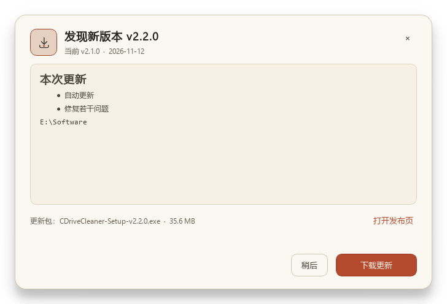

# CDriveCleaner v2.2.0

> 自动更新来了：启动检查新版本，下载后 SHA256 校验，安装版与便携版都能自动替换并重启。

## 自动更新

- 启动约 2.6 秒后后台检查 GitHub Release，每 24 小时最多一次。
- 发现新版本时，主窗口顶部显示提示条；可查看更新说明、稍后或关闭。
- 更新内容、版本号、更新包大小和下载进度都在更新对话框中展示。
- 下载后使用 GitHub Release asset 的 SHA256 digest 校验，校验失败拒绝安装。
- **安装版**：程序退出后由 PowerShell 等待新版 Setup 安装完成，再启动新版本。
- **便携版**：程序退出后解压新版 portable zip 覆盖程序目录，保留 `data\` 配置，再启动。
- **源码模式**：只打开发布页，不自动替换。
- 设置页可关闭自动检查，也可手动“检查更新”。

## 从这一版开始

v2.1.0 及更早版本没有自动更新代码，需要手动安装一次 v2.2.0。  
从 v2.2.0 起，后续版本可以通过应用内自动更新完成。

## 同时包含

- v2.1.0 的暖纸张 UI、字号与图标重做
- 移动归档保留目录结构
- 多选目录按目录名同级归档
- 自定义目录可多选
- 复制进度改为全程平均速度

## 下载

| 资产 | 说明 |
|---|---|
| `CDriveCleaner-Setup-v2.2.0.exe` | 安装版 |
| `CDriveCleaner-Portable-v2.2.0.zip` | 便携版，解压即用 |
| `CDriveCleaner-v2.2.0-SHA256SUMS.txt` | 下载校验 |

> 未做代码签名，SmartScreen 可能提示；请核对 SHA256。
